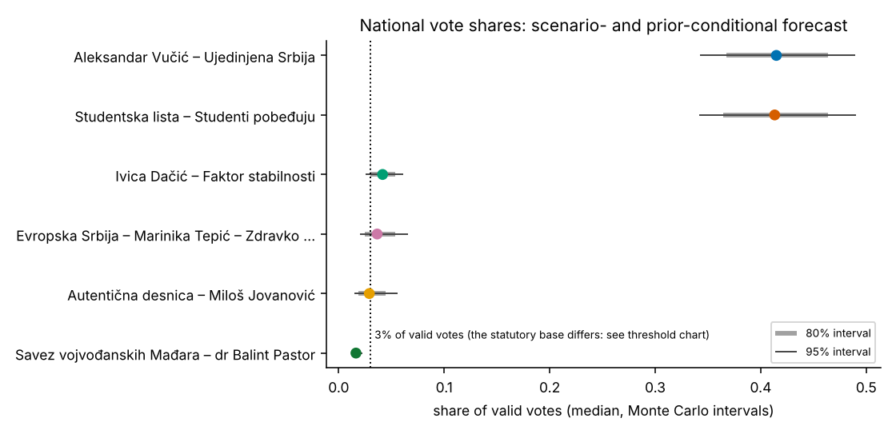

# Serbia parliamentary election forecast

A transparent, three-stage forecasting model for the next Serbian parliamentary election, built from municipality-level results, recent polls and local elections.

The model keeps three questions separate, because they have different answers:

1. **Votes**: national vote shares for each list.
2. **Seats**: allocation of the 250 seats under Serbian electoral law (D'Hondt, threshold, minority-list rules).
3. **Government**: which coalitions can reach a 126-seat majority.

Done in collaboration with Stefan Siridžanski.

## Headline results (archived run, polls up to 20 Sep 2026)

| List | Median vote share | Median seats | P(most votes) | P(majority alone) |
|---|---:|---:|---:|---:|
| SNS-led list | 41.5% | 109 | 50.6% | 6.4% |
| Student-backed list | 41.3% | 109 | 49.4% | 6.7% |
| SPS-led list | 4.2% | 10 | – | – |

The two main lists are statistically tied, and neither is likely to win a majority alone, so government formation depends on SPS, minority lists and smaller parties. Full results, uncertainty intervals, scenarios and caveats are in **[RESULTS_SUMMARY.md](RESULTS_SUMMARY.md)**.



These are conditional model outputs based on the stated inputs and assumptions, not predictions of a certain outcome.

## Method

- **20,000 national simulations** and 400 municipal draws across 192 geographic units
- Poll aggregation (5 polls, 3 pollsters) combined with a structural baseline from the 2023 parliamentary election
- Turnout modelling, local-election swing, and scenario mixtures for SPS voter realignment
- Seat allocation implemented from electoral law, with threshold and minority-list sensitivity checks
- Backtests (leave-region-out, new-list geography) and diagnostics in `sample_outputs/F_*`

Architecture and design decisions: [ARCHITECTURE.md](ARCHITECTURE.md). Known gaps and data still to obtain: [RESEARCH_LEADS.md](RESEARCH_LEADS.md).

## Repository layout

| Path | Contents |
|---|---|
| `run_forecast.ipynb` | Main Google Colab notebook: runs the full pipeline against BigQuery |
| `src/` | Forecasting modules (vote share, turnout, simulation, seat allocation, coalitions, charts, report) |
| `sql/` | BigQuery SQL for data checks and model panels, by stage |
| `tests/` | pytest suite (runs locally on DuckDB, no cloud account needed) |
| `config/` | List registry, coalition definitions, legal parameters, model settings, scenarios |
| `data/serbia_bigquery/` | Electoral and context CSVs, schemas, source manifest and BigQuery loader |
| `data_to_import/` | External inputs (polls, events, prediction markets) and templates |
| `sample_outputs/` | Result tables and figures from the archived run |
| `reference/` | Original SQL query the project started from |

## Run it

**Tests (local, no cloud needed; 183 tests):**

```bash
pip install -r requirements.txt
python -m pytest tests -q --pkg data/serbia_bigquery
```

**Full forecast:** load the CSVs into BigQuery with `data/serbia_bigquery/load_to_bigquery.sh PROJECT_ID DATASET_ID`, then open `run_forecast.ipynb` in Google Colab. The notebook asks for your project and dataset IDs at runtime.

## Data sources

Electoral and context data are aggregate public results with geography identifiers; no individual voter records are included. Every source's URL, publisher, date and hash is listed in [`source_manifest.csv`](data/serbia_bigquery/source_manifest.csv), and known data issues in [`quality_issues.csv`](data/serbia_bigquery/quality_issues.csv). Polls and political events were compiled from secondary sources and are labelled as such.

## Licence

No licence has been granted yet, so all rights are reserved. Third-party data remain subject to their publishers' terms.
