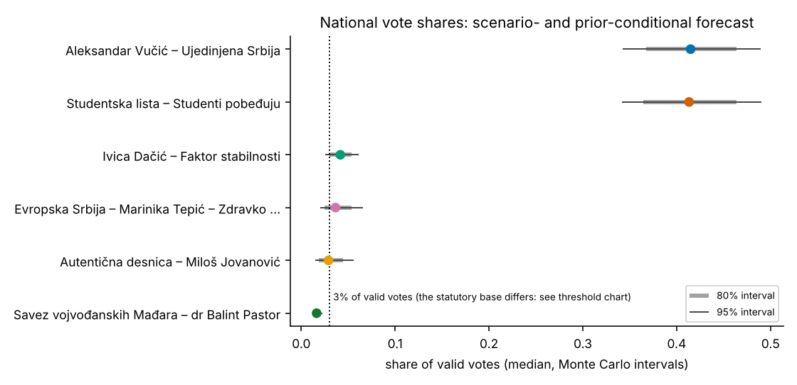
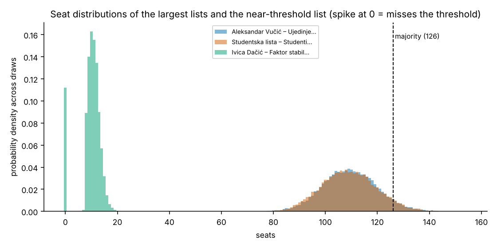
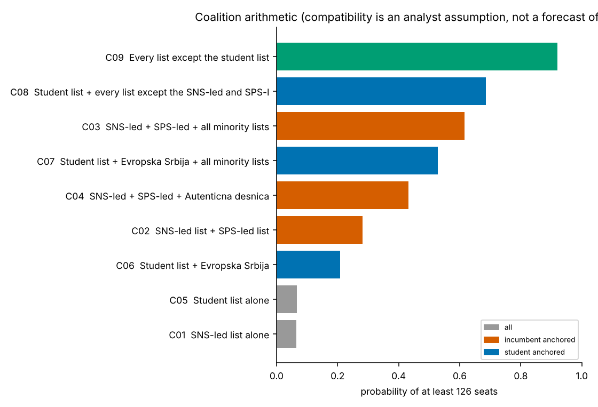
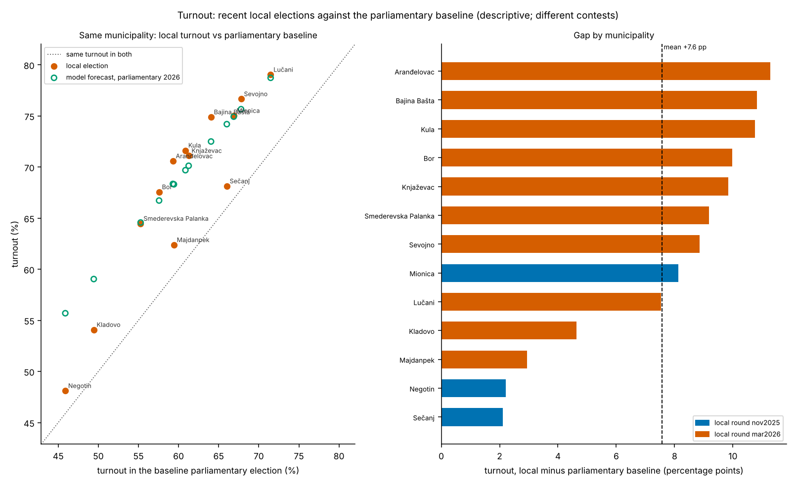

# Serbia parliamentary election forecast: v3 results summary

**Prepared:** 16 October 2026. **Run target:** 2026-10-25. **Status:** summary of an archived, scenario conditional model run. **In collaboration with: Stefan Siridžanski**

This report combines the model and configuration in `serbia_forecast_v3.zip` with the newest supplied results archive, `forecast_outputs (1).zip`. No new polls were added and no forecast was rerun to prepare this summary. The newer archive extends the earlier standalone `forecast_outputs.zip` with local election tables and additional scenario variants. Its core baseline is unchanged. The added G tables and two explicit multi list scenario variants require supplementary generation code for complete reproduction, which is not identified in the supplied v3 source.

**The archived baseline is a close contest.** The SNS-led list has a median valid-vote share of **41.5%**, compared with **41.3%** for the student-backed list. Both have **109 median seats**, below the configured majority requirement of **126**. The uncertainty ranges overlap substantially. Coalition arithmetic depends heavily on SPS, other threshold-adjacent lists, and the assumed participation of minority lists.

The archived probabilities of receiving the most votes are **50.6% for the SNS-led list** and **49.4% for the student-backed list**. Their standalone-majority probabilities are **6.4%** and **6.7%**, respectively. Higher majority probabilities for wider coalitions rely on additional compatibility assumptions.

**Publication note:** vote and seat figures below reproduce the archived baseline. Its seat calculations retain legacy threshold and minority-uplift settings. Section 10 explains the legal checks and sensitivity results; this report does not silently replace the archived allocation with a corrected forecast.

## 1. What the baseline includes

The forecast has three stages: national votes, parliamentary seats, and coalition-majority scenarios. A list receiving the most votes, a list receiving the most seats, and a government being formed are separate outcomes.

| Component | Archived setting |
| --- | --- |
| National simulations | 20,000 draws; seed 20261014 |
| Municipal simulations | 400 draws across 192 geographic units, including special electorates |
| Polling inputs | 5 manually imported observations attributed to 3 pollsters |
| Last poll in the archived run | 2026-09-20 |
| Participation assumption | 4,300,000–4,400,000 participating voters |
| SPS realignment | An equally weighted mixture of no, moderate, and stronger SPS-to-student movement |
| Local-election carry-over | Headline municipal map uses alpha = 0; alpha = 0.5 and 1 are geographic sensitivity cases |
| Prediction markets | External comparisons only; not inputs to the national vote model |

The realignment mixture assumes mean transfers of **0%, 10%, or 25% of the SPS poll-vote pool**, with one-third weight on each case. These percentages and weights are analyst assumptions. The event log activates the mixture, but political departures and endorsements do not measure individual voter switching. The label **baseline** therefore includes a political-event adjustment.

Polling observations and roster entries were imported from secondary sources. Their presence in the project does not independently establish the accuracy of the original publications or the official status of each configured list.

Sources: [G_baseline_definition.csv](sample_outputs/G_baseline_definition.csv), [F_diag_polls.csv](sample_outputs/F_diag_polls.csv), [run_metadata.json](sample_outputs/run_metadata.json).

## 2. National votes and vote shares

Shares below use **valid votes** as the denominator. Expected values are simulation means. Median values and central 80%/95% intervals describe the archived model distribution. Vote totals are rounded to the nearest 1,000 to avoid implying precision beyond the inputs.

| Configured list | Expected votes | Median votes | Mean share | Median share | 80% share interval | 95% share interval |
| --- | --- | --- | --- | --- | --- | --- |
| SNS-led list | 1,753,000 | 1,752,000 | 41.5% | 41.5% | 36.7–46.4% | 34.2–49.0% |
| Student-backed list | 1,748,000 | 1,746,000 | 41.4% | 41.3% | 36.4–46.4% | 34.1–49.0% |
| SPS-led list | 177,000 | 176,000 | 4.2% | 4.2% | 3.0–5.4% | 2.5–6.1% |
| Evropska Srbija – Marinika Tepić – Zdravko Ponoš | 161,000 | 154,000 | 3.8% | 3.6% | 2.4–5.4% | 2.0–6.6% |
| Autentična desnica – Miloš Jovanović | 129,000 | 123,000 | 3.1% | 2.9% | 1.9–4.4% | 1.5–5.6% |
| Savez vojvođanskih Mađara – dr Balint Pastor | 70,000 | 69,000 | 1.7% | 1.6% | 1.3–2.0% | 1.2–2.2% |
| Bogoljub Karić – Pokret snaga Srbije – BK | 24,000 | 19,000 | 0.6% | 0.4% | 0.1–1.2% | 0.1–1.9% |
| Grupa građana „Ćale, ovo je za tebe“ – Petar Đurić | 24,000 | 19,000 | 0.6% | 0.4% | 0.1–1.2% | 0.1–1.8% |
| Liberalno zelena stranka – za slobodnu i čistiju Srbiju | 24,000 | 19,000 | 0.6% | 0.4% | 0.1–1.2% | 0.1–1.8% |
| Vladimir Gajić – Alternativa za Srbiju – Narodna stranka, Bunt – prava Srbija | 24,000 | 19,000 | 0.6% | 0.4% | 0.1–1.2% | 0.1–1.8% |
| Usame Zukorlić – Pokret za ujedinjenje | 22,000 | 22,000 | 0.5% | 0.5% | 0.3–0.7% | 0.2–0.8% |
| Albanska koalicija – Koalicioni Shqiptar | 18,000 | 18,000 | 0.4% | 0.4% | 0.3–0.5% | 0.3–0.6% |
| SDA Sandžaka – čuvari Sandžaka | 17,000 | 17,000 | 0.4% | 0.4% | 0.2–0.5% | 0.2–0.6% |
| Ruska stranka – Srbija u Briksu – Slobodan Nikolić | 10,000 | 10,000 | 0.2% | 0.2% | 0.2–0.3% | 0.1–0.4% |
| Biram pravdu, biram budućnost – koalicija snaga | 8,000 | 7,000 | 0.2% | 0.2% | 0.0–0.4% | 0.0–0.6% |
| Rasim Ljajić – Ljudski (SDP – CDP) | 8,000 | 6,000 | 0.2% | 0.2% | 0.0–0.4% | 0.0–0.6% |
| Majka Srbija – Gruda | 4,000 | 3,000 | <0.1% | <0.1% | 0.0–0.2% | 0.0–0.3% |
| Stranka rusko-srpskog jedinstva – Rusi i Srbi braća zauvek | 2,000 | 1,000 | <0.1% | <0.1% | 0.0–0.1% | 0.0–0.1% |

The probability of receiving the most votes is **50.6% for the SNS-led list** and **49.4% for the student-backed list**. Every other configured list has zero first-place outcomes in this archived sample. A zero simulation count is not a guarantee about an actual election.

The two leading median shares differ by only **0.16 percentage points**. That difference is small relative to the uncertainty intervals and the changes caused by omitting individual pollsters. Marginal medians and interval endpoints do not have to sum to 100%; simulation mean shares do sum to 100% before display rounding.

The archived chart displays selected lists; the table includes all configured lists. The dotted 3% line uses valid-vote share for visual reference and is not the statutory threshold denominator.

Sources: [A_national_votes_shares_seats.csv](sample_outputs/A_national_votes_shares_seats.csv).

## 3. Parliamentary seats and threshold risk

The archived allocation distributes **250 seats** using the configured largest-quotient calculation. A standalone majority requires **126 seats**. The following ordinary-list threshold probabilities use the archived `voters_turned_out` denominator; they are not probabilities of reaching 3% of valid votes.

| Ordinary list | Expected seats | Median seats | 80% seat interval | 95% seat interval | P(crosses archived threshold) | P(at least one seat) |
| --- | --- | --- | --- | --- | --- | --- |
| SNS-led list | 109.5 | 109 | 96–123 | 90–130 | 100.0% | 100.0% |
| Student-backed list | 109.1 | 109 | 95–123 | 89–130 | 100.0% | 100.0% |
| SPS-led list | 9.8 | 10 | 0–14 | 0–16 | 88.8% | 88.8% |
| Evropska Srbija – Marinika Tepić – Zdravko Ponoš | 7.7 | 9 | 0–14 | 0–17 | 70.3% | 70.3% |
| Autentična desnica – Miloš Jovanović | 4.2 | 0 | 0–11 | 0–14 | 42.5% | 42.5% |
| Vladimir Gajić – Alternativa za Srbiju – Narodna stranka, Bunt – prava Srbija | 0.0 | 0 | 0–0 | 0–0 | 0.3% | 0.3% |
| Bogoljub Karić – Pokret snaga Srbije – BK | 0.0 | 0 | 0–0 | 0–0 | 0.3% | 0.3% |
| Grupa građana „Ćale, ovo je za tebe“ – Petar Đurić | 0.0 | 0 | 0–0 | 0–0 | 0.3% | 0.3% |
| Liberalno zelena stranka – za slobodnu i čistiju Srbiju | 0.0 | 0 | 0–0 | 0–0 | 0.2% | 0.2% |

| Outcome | P(most votes) | P(most seats, ties included) | P(majority alone) |
| --- | --- | --- | --- |
| SNS-led list | 50.6% | 51.7% | 6.4% |
| Student-backed list | 49.4% | 50.3% | 6.7% |

A tie for the most seats counts for both lists in the seat-leadership probabilities, so those two percentages can add to more than 100%. They are not mutually exclusive winning probabilities. A median of 109 seats also does not imply that the two lists would receive exactly the same seats in an election.

A reported central 95% seat range of 0–0 for a very small list can coexist with a small nonzero representation probability: rare positive-seat outcomes fall outside that central interval. The CSV contains unrounded values.

Sources: [A_national_votes_shares_seats.csv](sample_outputs/A_national_votes_shares_seats.csv), [B_seat_majority_probabilities.csv](sample_outputs/B_seat_majority_probabilities.csv), [B_threshold_votes.csv](sample_outputs/B_threshold_votes.csv).

### SPS is an important threshold sensitivity

The SPS-led list's median valid-vote share is above the threshold, but its lower tail includes exclusion from seat allocation. This creates a nonlinear seat effect rather than a smooth proportional reduction.

| SPS condition | Share of draws | P(SNS-anchored majority available) | P(student-anchored majority available) | SNS median seats | Student median seats |
| --- | --- | --- | --- | --- | --- |
| takes part (>= threshold) | 88.8% | 66.6% | 66.4% | 109 | 108 |
| below threshold (no seats) | 11.2% | 42.5% | 85.3% | 113 | 115 |

These are conditional subsets of the same simulations. They do not isolate the causal effect of removing SPS: poll strength, assumed voter movements, and other list outcomes also differ between the subsets. Coalition probabilities describe the configured collection of coalitions, not the probability that a government agreement will be signed.

Sources: [E_conditional_on_threshold.csv](sample_outputs/E_conditional_on_threshold.csv), [E_threshold_sweeps.csv](sample_outputs/E_threshold_sweeps.csv).

## 4. Minority lists and phi

The **9 lists flagged as minority lists in the configuration** have a combined expected **9.6 seats**. Their aggregate median is **10 seats**, with an 80% range of **8–11**. Minority status here is an input requiring confirmation against the applicable RIK decisions.

| Configured minority list | Expected votes | Median valid-vote share | Expected seats | Median seats | 95% seat interval | P(at least one seat) |
| --- | --- | --- | --- | --- | --- | --- |
| Savez vojvođanskih Mađara – dr Balint Pastor | 70,000 | 1.6% | 5.42 | 5 | 4–7 | 100.0% |
| Usame Zukorlić – Pokret za ujedinjenje | 22,000 | 0.5% | 1.36 | 1 | 0–2 | 94.4% |
| Albanska koalicija – Koalicioni Shqiptar | 18,000 | 0.4% | 1.03 | 1 | 1–2 | 99.6% |
| SDA Sandžaka – čuvari Sandžaka | 17,000 | 0.4% | 0.91 | 1 | 0–2 | 84.4% |
| Rasim Ljajić – Ljudski (SDP – CDP) | 8,000 | 0.2% | 0.28 | 0 | 0–2 | 24.4% |
| Biram pravdu, biram budućnost – koalicija snaga | 8,000 | 0.2% | 0.28 | 0 | 0–2 | 24.1% |
| Ruska stranka – Srbija u Briksu – Slobodan Nikolić | 10,000 | 0.2% | 0.26 | 0 | 0–1 | 25.7% |
| Majka Srbija – Gruda | 4,000 | <0.1% | 0.05 | 0 | 0–1 | 4.1% |
| Stranka rusko-srpskog jedinstva – Rusi i Srbi braća zauvek | 2,000 | <0.1% | 0.00 | 0 | 0–0 | <0.1% |

The configured SNS+SPS bloc reaches a majority without minority lists in **28.2%** of draws. All other non-minority lists combined do so in **34.7%**. Neither side reaches that majority without minority seats in **37.1%**. This is parliamentary arithmetic, not evidence that minority parties share a single negotiating position.

**Phi describes turnout responsiveness, not coalition loyalty.** Phi = 0 leaves historical minority-group vote pools unchanged by the change in national valid votes, apart from other modeled shocks and within-group competition. Phi = 1 scales those historical pools proportionally to national valid votes. The baseline draws phi uniformly between 0 and 1. Prior-only lists have a separate vote prior and do not follow that historical-pool formula. Neither value means that minority parties support SNS or the students.

Sources: [A_national_votes_shares_seats.csv](sample_outputs/A_national_votes_shares_seats.csv), [C_bloc_seat_quantiles.csv](sample_outputs/C_bloc_seat_quantiles.csv), [C_minority_pivotality.csv](sample_outputs/C_minority_pivotality.csv), [G_scenario_guide.csv](sample_outputs/G_scenario_guide.csv).

## 5. Coalition majorities and government formation

These calculations ask whether specified combinations have enough seats. Compatibility is supplied through configuration; it is not estimated from ballot data. In particular, scenarios containing all minority lists or every non-incumbent list assume much broader cooperation than has been demonstrated by the data.

Coalition seat intervals below are **90% intervals**, from the supplied 5th and 95th percentiles.

| Configured combination | Median seats | 90% seat interval | P(majority) | Source classification |
| --- | --- | --- | --- | --- |
| SNS-led + SPS-led + all minority lists | 129 | 111–147 | 61.7% | assumed |
| SNS-led + SPS-led + Autenticna desnica | 124 | 106–141 | 43.2% | assumed |
| Student list + Evropska Srbija | 117 | 99–135 | 20.8% | assumed |
| Student list + Evropska Srbija + all minority lists | 126 | 109–144 | 52.8% | assumed |
| Student list + every list except the SNS-led and SPS-led lists | 131 | 113–148 | 68.6% | assumed |
| SNS-led list + SPS-led list | 119 | 102–137 | 28.2% | plausible by precedent |
| SNS-led list alone | 109 | 93–127 | 6.4% | mathematical only |
| Student list alone | 109 | 92–127 | 6.7% | mathematical only |
| Every list except the student list | 141 | 123–158 | 92.0% | mathematical only |

The source labels such as “plausible by precedent” describe model configuration, not a verified coalition agreement. The “every list except the student list” combination is explicitly mathematical-only.

| Mutually exclusive arithmetic outcome | Probability |
| --- | --- |
| only an incumbent-anchored coalition has a majority | 31.4% |
| only a student-anchored coalition has a majority | 36.1% |
| both kinds have a majority (order of invitation not modelled) | 32.4% |
| neither kind has a majority among the listed coalitions | 0.0% |

At least one incumbent-anchored option has a majority in **63.9%** of draws; at least one student-anchored option does in **68.6%**. These events overlap. The zero count for “neither” reflects the breadth of the allowed combinations and does not rule out negotiations failing, conflicting demands, or political deadlock. The model does not estimate the invitation process or bargaining outcomes.

Sources: [C_coalitions.csv](sample_outputs/C_coalitions.csv), [C_government_formation_conditional.csv](sample_outputs/C_government_formation_conditional.csv).

## 6. Turnout and recent local elections

The user-specified participation range is **4,300,000–4,400,000 voters**. With the model's configured national register, that implies turnout of approximately **66.7%–68.2%**. The register is an imported secondary-source value and municipal registers are inferred through scaling.

The supplied 2023 baseline records **3,820,746 participants**, or **58.8% turnout**. The scenario therefore implies roughly **479,000–579,000 more participants in total**. This net difference does not identify how many individual former abstainers return; new voters, departures, and changes in the electorate also matter.

For the same 13 municipalities, pooled turnout rises from **58.2%** in the parliamentary baseline to **66.3%** in their local elections. Participants rise from **179,853 to 201,732**. All 13 have higher local turnout, but they are a selected group observed at different election dates.

Turnout means participating voters divided by registered voters. A list's vote share means its votes divided by valid votes. The parliamentary SNS-led list and a later local coalition can have different partners. None of these measures reveals SNS-only turnout from a joint-list result.

| Municipality | Local date | 2023 turnout | Local turnout | 2023 SNS-led list votes | Local lead-coalition votes | 2023 list share | Local list share |
| --- | --- | --- | --- | --- | --- | --- | --- |
| Mionica | 2025-11-30 | 66.9% | 75.0% | 4,144 | 4,157 | 58.7% | 53.1% |
| Negotin | 2025-11-30 | 45.9% | 48.1% | 10,582 | 11,532 | 66.1% | 69.3% |
| Sečanj | 2025-11-30 | 66.0% | 68.1% | 4,060 | 4,103 | 64.1% | 60.5% |
| Aranđelovac | 2026-03-29 | 59.3% | 70.6% | 10,473 | 13,030 | 49.1% | 51.0% |
| Bajina Bašta | 2026-03-29 | 64.1% | 74.9% | 6,751 | 8,467 | 51.2% | 53.9% |
| Bor | 2026-03-29 | 57.6% | 67.5% | 10,438 | 12,516 | 46.6% | 49.0% |
| Kladovo | 2026-03-29 | 49.4% | 54.1% | 6,270 | 8,043 | 61.9% | 72.0% |
| Knjaževac | 2026-03-29 | 61.3% | 71.1% | 8,296 | 8,879 | 61.3% | 57.4% |
| Lučani | 2026-03-29 | 71.5% | 79.0% | 5,950 | 6,972 | 56.9% | 61.5% |
| Majdanpek | 2026-03-29 | 59.4% | 62.4% | 5,402 | 6,079 | 61.4% | 65.6% |
| Smederevska Palanka | 2026-03-29 | 55.3% | 64.5% | 11,951 | 14,181 | 56.8% | 58.0% |
| Sevojno | 2026-03-29 | 67.8% | 76.6% | 1,824 | 2,108 | 49.4% | 50.5% |
| Kula | 2026-03-29 | 60.9% | 71.6% | 10,913 | 11,796 | 54.9% | 50.4% |

The earlier parliamentary vote counts above are reconstructed in the supplied G table from the baseline share and valid votes, then rounded to whole votes.

Across the 13 municipalities, the unweighted mean change in the lead list's valid-vote share is **+1.06 percentage points**. Comparing local coalitions with the mapped 2023 political-family totals instead gives a reported mean of **-7.01 points across 10 non-missing proxy rows**. These use different comparisons and sample coverage. Neither is an observed change in SNS-only support.

Aranđelovac is marked `excluded_reconciliation_failure` in the extended G table, yet its non-missing proxy remains in the 10-row descriptive diagnostic. Restricting that table to the 9 rows marked `proxy_model` gives about **-6.97 points**. The archived national forecast is unchanged here. Local list labels based on student/youth name hints are also unverified affiliations and must not be treated as confirmed student-backed organizations.

Local-versus-parliamentary comparisons do not identify a causal effect of holding a local election. The baseline municipal map uses alpha = 0; alternative alpha maps do not establish how much local swing should carry into the national election.

Orange markers show observed local turnout. Green markers show the model projection calibrated to the user participation range. The diagonal marks equal turnout in both elections; the right panel reports observed local-minus-parliamentary gaps.

Sources: [G_turnout_levels_by_group.csv](sample_outputs/G_turnout_levels_by_group.csv), [G_turnout_local_vs_parliamentary_by_municipality.csv](sample_outputs/G_turnout_local_vs_parliamentary_by_municipality.csv), [G_local_swing_by_municipality.csv](sample_outputs/G_local_swing_by_municipality.csv), [G_local_swing_summary.csv](sample_outputs/G_local_swing_summary.csv), [F_diag_local_elections.csv](sample_outputs/F_diag_local_elections.csv).

## 7. Which assumptions change the result?

### SPS movement and political-event assumptions

The following cases keep the other baseline settings and replace the SPS realignment component.

| Case | SNS median share | Student median share | SPS median share | SNS median seats | Student median seats | P(student most seats, ties included) |
| --- | --- | --- | --- | --- | --- | --- |
| Baseline mixture | 41.5% | 41.3% | 4.2% | 109 | 109 | 50.3% |
| No extra event movement | 41.5% | 40.8% | 4.7% | 109 | 107 | 47.4% |
| Moderate SPS movement | 41.5% | 41.3% | 4.2% | 109 | 109 | 50.0% |
| Stronger SPS movement | 41.5% | 42.0% | 3.5% | 110 | 111 | 53.8% |

**“Polls only” switches off the additional political-event mixture. It does not remove polling data, historical geography, minority assumptions, or turnout settings.** The supplied outputs do not contain a validated national forecast with all external sources removed. Departures and endorsements are event records; transfer percentages remain scenarios.

### Pollster dependence

Omitting a pollster changes the balance more than the small baseline lead. These cases test sensitivity to source inclusion; they do not establish which pollster is right.

| Pollster omitted | SNS median share | Student median share | SNS median seats | Student median seats | P(SNS most seats) | P(student most seats) |
| --- | --- | --- | --- | --- | --- | --- |
| CRTA with Democracy Action Lab (Stanford) | 43.7% | 38.6% | 115 | 102 | 73.2% | 28.3% |
| Faktor plus | 38.4% | 44.9% | 102 | 119 | 23.0% | 78.2% |
| NSPM (Nova srpska politicka misao) | 42.4% | 40.6% | 112 | 107 | 58.9% | 42.9% |

The imported polling panel contains limited coverage, partially missing sample information, and substantial pollster disagreement. The model combines pollster effects with assumptions about sampling, opinion movement, and an election-day polling miss. The resulting intervals are conditional on those assumptions; their electoral coverage has not been established through repeated national backtests.

### Mobilization and opposition-list scenarios

These are shifts imposed on the model, not measured rates of persuasion or turnout. The latest output guide distinguishes the two-list fragmentation/consolidation variants from the older generic names.

| Assumed case | SNS median share | Student median share | SNS median seats | Student median seats | P(student-anchored majority available) |
| --- | --- | --- | --- | --- | --- |
| Stronger student-list support | 39.7% | 43.6% | 105 | 115 | 83.5% |
| Stronger SNS-list support | 43.3% | 39.1% | 114 | 103 | 50.9% |
| 10% student pool to Evropska Srbija | 41.5% | 37.2% | 109 | 97 | 71.9% |
| 25% Evropska Srbija pool to students | 41.5% | 42.3% | 110 | 112 | 65.3% |
| 5% student pool to each of two lists | 41.5% | 37.3% | 107 | 96 | 77.5% |
| 25% of each of two list pools to students | 41.5% | 43.1% | 111 | 115 | 63.9% |

The student-list seat total and the availability of a wider student-anchored majority can move in different directions. Moving votes between lists can change which lists clear the threshold and which partners are available. Consolidation therefore does not mechanically improve every coalition-majority metric.

Within the requested 4.3–4.4 million participation range, both leading median seat totals stay at 109 in the fixed low/high cases. The model does not estimate the preferences of additional participants separately, which limits what that sensitivity says about real turnout effects. Two additional turnout cases in the source archive lie outside the requested range and are stress tests, not part of the headline assumption.

Phi = 0 and phi = 1 minority scenarios also leave the main contest close. They change minority vote pools and some coalition arithmetic, rather than assigning minority voters or parties to a governing camp.

Sources: [E_scenario_comparison.csv](sample_outputs/E_scenario_comparison.csv), [G_scenario_guide.csv](sample_outputs/G_scenario_guide.csv), [E_threshold_sweeps.csv](sample_outputs/E_threshold_sweeps.csv).

## 8. Validation evidence and its limits

The archived historical check concerns the **distribution of national totals across municipalities** in 2022–2023. It conditions on the actual later national totals and municipal valid-vote totals. It therefore tests geography reconstruction, not the ability to predict national vote shares before an election.

| Conditional geography method | Mean family MAE (pp) | Mean family RMSE (pp) | Vote-weighted municipality winner accuracy |
| --- | --- | --- | --- |
| carry_forward_2022_shares | 11.58 | 12.28 | 99.1% |
| proportional_swing_IPF | 1.27 | 1.72 | 93.0% |
| additive_uniform_swing | 1.57 | 2.07 | 96.0% |

The source CSV calls the aggregate error a “vote-weighted mean.” In `src/backtest.py`, each family error is weighted across municipalities by valid votes, but the final aggregate is the arithmetic mean across families. The labels above reflect that calculation.

The carry-forward comparator does not impose the known later national totals and gives new families unit weights of 1 before row normalization. Its large error is not a like-for-like demonstration that the preferred method has superior prospective forecast accuracy. The archive lacks the historical poll/result pairs needed to backtest national ranking probabilities and interval coverage. It also lacks the earlier turnout/register observations needed for a proper time-based turnout-rate backtest.

The delivered market diagnostic contains Polymarket quotes with incomplete question/resolution information. It does not establish a comparable Meridianbet series or verified liquidity. Those quotes are not used as vote shares or as independent confirmation of the forecast.

Sources: [F_backtest_geography_methods.csv](sample_outputs/F_backtest_geography_methods.csv), [F_backtest_new_list_geography.csv](sample_outputs/F_backtest_new_list_geography.csv), [F_diag_market_quotes.csv](sample_outputs/F_diag_market_quotes.csv).

## 9. Checks performed for this summary

- All 18 national mean vote shares sum to 100% before display rounding, and expected seats sum to 250.
- The municipal output has 192 distinct units × 18 lists, with no duplicate unit/list keys. Mean list shares sum to 100% within each unit, and mean list votes reconcile to the unit's mean valid votes.
- National summaries use 20,000 draws; municipal summaries use 400 selected draws. Their separately averaged valid-vote totals differ slightly and should not be forced to match as if they used identical samples.
- Vote, threshold, seat, and coalition figures were read from their corresponding CSVs. Coalition 5th–95th percentile ranges are labelled 90%, not 95%.
- At a 50% event probability, 20,000 independent draws imply an approximate Monte Carlo standard error of 0.35 percentage points. This numerical error is distinct from political and model uncertainty.
- These checks do not establish national predictive calibration or validate every original political input. No live BigQuery query or new simulation was run for this document.

## 10. Legal settings requiring attention

The archived baseline uses `voters_turned_out` for the threshold and `all_minority` for the 1.35 quotient multiplier. The v3 legal comments cite an older consolidated law. The report preserves those outputs so their provenance remains clear.

The [law text hosted by RIK, Articles 121 and 128](https://www.rik.parlament.gov.rs/extfile/sr/325867/BOS_6.%20Zakon%20o%20izboru%20narodnih%20poslanika.pdf) defines the threshold's voter count using ballots found in ballot boxes. In this dataset that corresponds to `ballots_cast`, including invalid ballots, rather than attendance or valid votes alone. The [RIK parliamentary-election guide](https://www.rik.parlament.gov.rs/tekst/77/o-izborima-za-narodne-poslanike.php) describes the 35% minority quotient increase for eligible minority lists below 3%.

The supplied same-draw sensitivities show:

| Threshold denominator | P(SPS takes part) | SNS expected seats | Student expected seats |
| --- | --- | --- | --- |
| voters_turned_out | 88.8% | 109.45 | 109.13 |
| ballots_cast | 88.9% | 109.44 | 109.12 |
| valid_ballots | 90.6% | 109.16 | 108.84 |

Switching the minority uplift to below-threshold-only gives identical results in these archived draws: none of the configured minority lists reaches the ordinary threshold. The denominator change is small numerically in this run, but it should be resolved correctly in a production forecast. Full coalition outputs have not been regenerated here under the legally aligned settings.

Official list eligibility and minority decisions also require verification. The v3 allocation functions do not receive list-specific candidate-count caps. These are implementation/source-review matters, separate from uncertainty about voter preferences.

Sources: [B_threshold_sensitivity.csv](results/B_threshold_sensitivity.csv), [run_metadata.json](results/run_metadata.json).

## 11. Reproducibility and source files

The report and `results/` folder can be uploaded together at the repository root. Relative links and charts then work on GitHub. The numeric CSVs in that folder are unchanged from the selected results archive. Only the OS/kernel fingerprint was removed from its copied metadata file. Personal cloud identifiers, credentials, and private account details are not included in this summary.

Useful starting points:

- [National vote and seat distributions](sample_outputs/A_national_votes_shares_seats.csv)
- [Seat-leadership and standalone-majority events](sample_outputs/B_seat_majority_probabilities.csv)
- [Configured coalition combinations](sample_outputs/C_coalitions.csv)
- [Overlapping coalition-majority events](sample_outputs/C_government_formation_conditional.csv)
- [Scenario results](sample_outputs/E_scenario_comparison.csv) and [their definitions](sample_outputs/G_scenario_guide.csv)
- [Local turnout and results](sample_outputs/G_local_swing_by_municipality.csv)
- [Run settings](sample_outputs/run_metadata.json) and [output manifest](sample_outputs/OUTPUT_MANIFEST.csv)

The target date is recorded in the archived run. An [RIK training-plan page](https://www.rik.parlament.gov.rs/tekst/475144/plan-sprovodjenja-obuka-birackih-odbora-u-stalnom-i-prosirenom-sastavu-za-izbore-za-narodne-poslanike-narodne-skupstine-raspisane-za-25-oktobar-2026-godine.php), consulted on 16 October 2026, also identifies the election scheduled for 25 October 2026. This date check does not authenticate the separately imported polling, political-event, roster, or voter-register records.

